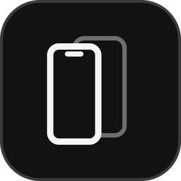
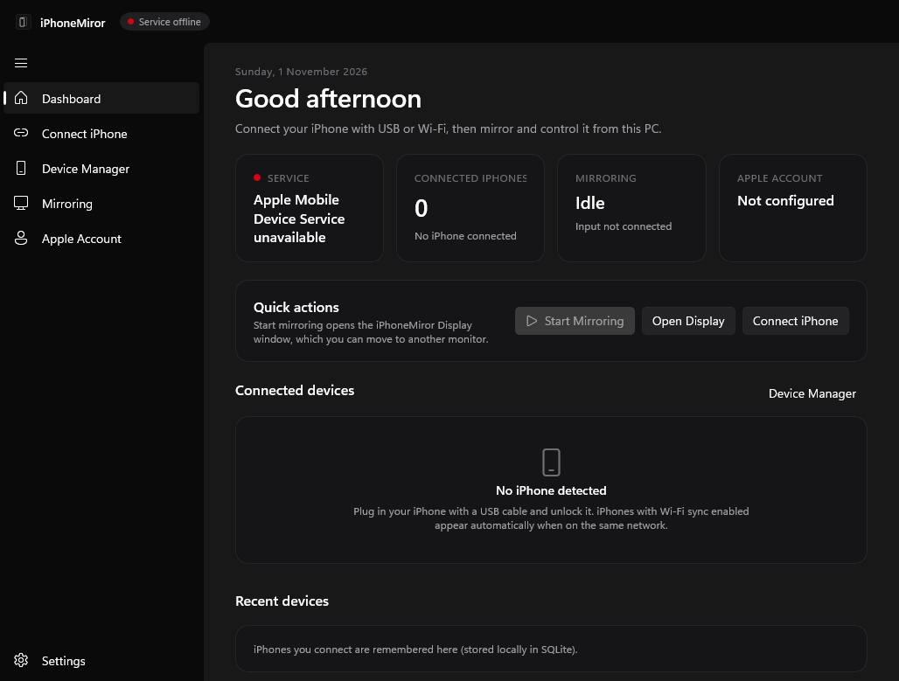
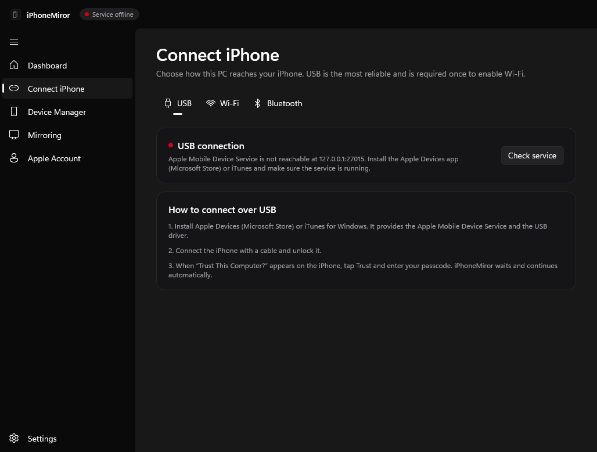
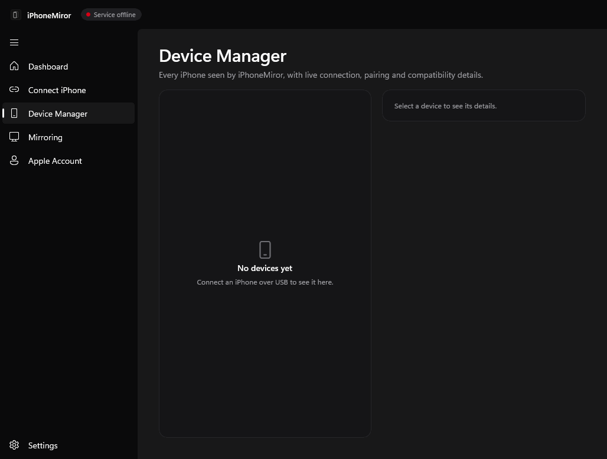
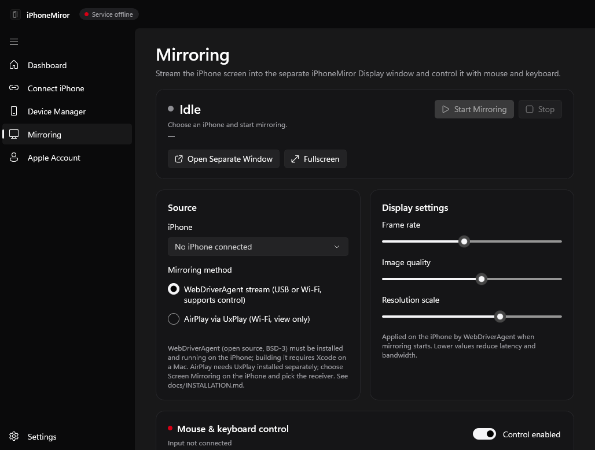
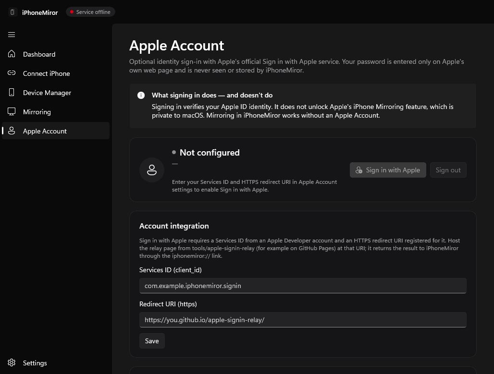
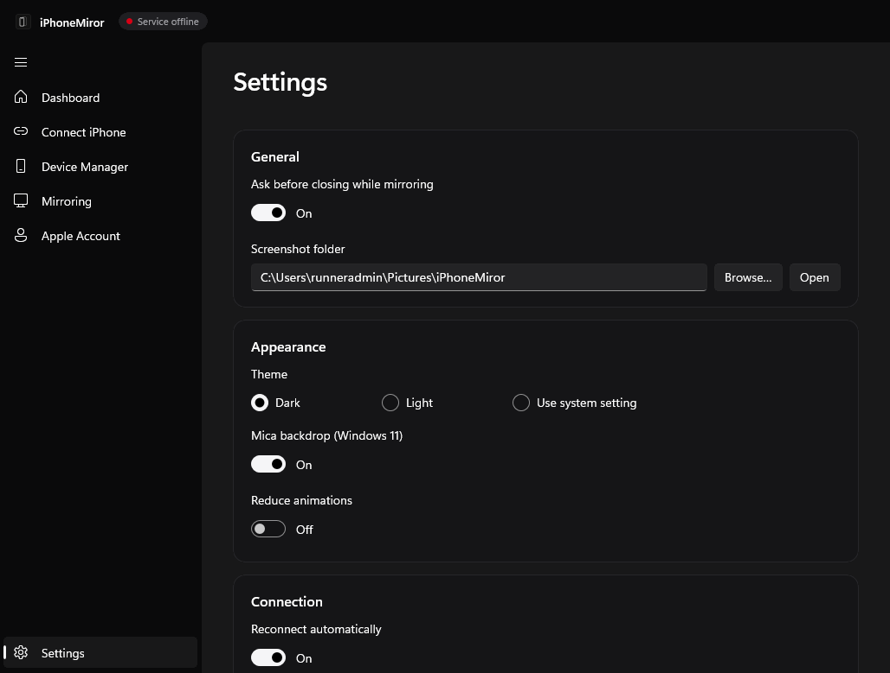
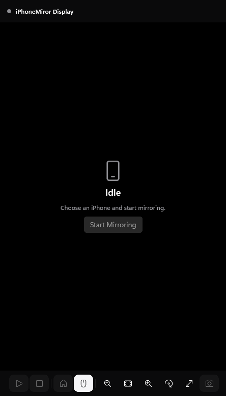

<p align="center">
  
</p>

<h1 align="center">iPhoneMiror</h1>

<p align="center">Connect, mirror and control an iPhone from Windows 11 — native WinUI 3 app built on .NET 10.</p>

<p align="center">
  <a href="https://github.com/aldiianshr-commits/iPhoneMiror/actions/workflows/ci.yml"></a>
  
  
  
</p>

> **Honest status:** the app builds for x64 and ARM64, the x64 build launches and renders every page in CI (Windows Server 2025 runner),
> and 68 unit tests + 12 protocol-level integration tests pass on Windows and Linux.
> It has **not yet been verified with a physical iPhone** — see [docs/COMPATIBILITY.md](docs/COMPATIBILITY.md).
> Apple's own *iPhone Mirroring* protocol is private and Mac-only; iPhoneMiror uses documented/open alternatives instead.

## Features

| Area | What it does | How |
|---|---|---|
| USB | Automatic detection, device identification, connection status, **Trust This Computer** pairing, auto-reconnect on re-plug | usbmux + lockdown protocol via Apple Mobile Device Service |
| Wi-Fi | Uses iPhones attached over the network, mDNS discovery, connection monitoring, auto-reconnect | Apple "Wi-Fi sync" attachments, `_apple-mobdev2._tcp` / `_remotepairing._tcp` |
| Bluetooth | Adapter check, Apple BLE detection, classic discovery and Windows pairing (no video — by design) | Windows Bluetooth APIs |
| Device info | Name, model, iOS version (auto-detected), connection type, battery, per-version compatibility report | lockdownd over TLS |
| Mirroring | Real-time stream, aspect ratio preserved, quality/frame-rate/scale, rotation handling, auto-reconnect | WebDriverAgent MJPEG (USB or Wi-Fi) · AirPlay via external UxPlay |
| Display window | Separate **iPhoneMiror Display** window: resizable, fullscreen (F11), portrait/landscape, zoom, connection indicator, start/stop, screenshot | WinUI 3 `AppWindow` |
| Control | Click → tap, double-click → double tap, hold → long press, drag → swipe, wheel → scroll, typing, Home | WebDriverAgent (XCTest) commands |
| Apple Account | Sign in with Apple (official OIDC), status, sign out; no password handling | `appleid.apple.com` + JWKS validation, Credential Manager |
| App | Dark/light theme, Mica, sidebar navigation, recent devices (SQLite), logs, startup options | MVVM + DI |

## Screenshots

Captured automatically by CI on a GitHub-hosted Windows runner (no iPhone attached, so device lists are empty and the
service shows as offline there):

| Dashboard | Connect iPhone |
|---|---|
|  |  |
| **Device Manager** | **Mirroring** |
|  |  |
| **Apple Account** | **Settings** |
|  |  |

**iPhoneMiror Display** window: 

## Test results

| Suite | Windows | Linux | Covers |
|---|---|---|---|
| Unit tests | 68 / 68 passed | 68 / 68 passed | plist (XML + binary), usbmux, lockdown framing, pairing certificates, DNS/mDNS, MJPEG, coordinate/gesture/keyboard mapping, WebDriverAgent routes, Sign in with Apple token validation, SQLite, settings, compatibility, performance |
| Integration tests | 12 / 12 passed | 12 / 12 passed | usbmux → lockdown → Trust dialog → pairing → TLS session → device info/battery, re-plug reconnect, denied trust, service down; input and MJPEG mirroring through a usbmux tunnel to an emulated WebDriverAgent |
| UI smoke test | passed | — | launches `iPhoneMiror.exe`, renders all pages and the Display window, records resource usage |

Integration tests use protocol emulators, not a physical iPhone.

## Download

Get the installer or portable ZIP (x64 / ARM64) from [Releases](https://github.com/aldiianshr-commits/iPhoneMiror/releases)
(`nightly` is rebuilt from every commit to `main`). Then follow [docs/INSTALLATION.md](docs/INSTALLATION.md).

**Requirements:** Windows 11 · *Apple Devices* (Microsoft Store) or *iTunes* for the Apple Mobile Device Service ·
for mirroring and control: WebDriverAgent running on the iPhone (needs a Mac to build once), or UxPlay for view-only AirPlay.

## Why WebDriverAgent?

iOS offers no public API for a Windows PC to capture the iPhone screen or inject touches, and Apple's Continuity/iPhone Mirroring
protocols are private. The legal, documented route is Apple's **XCTest** UI-testing framework, packaged by the open-source
**WebDriverAgent** (BSD-3). It provides both a screen stream and touch/keyboard events, over USB (tunnelled through usbmux) or Wi-Fi.
Details and the rejected alternatives are in [docs/RESEARCH.md](docs/RESEARCH.md).

## Project structure

```
iPhoneMiror.slnx                   all projects (Windows)
iPhoneMiror.Libraries.slnx         libraries + tests (any OS)
src/
  iPhoneMiror.App/                 WinUI 3 app: views, view models, DI, Display window, Windows services
  iPhoneMiror.Core/                models, interfaces, plist codec, SQLite, settings, logging, Sign in with Apple, compatibility
  iPhoneMiror.Connection/          usbmux, lockdown (TLS), pairing, DeviceConnectionService, DeviceTransport
  iPhoneMiror.DeviceDiscovery/     mDNS/DNS-SD browser, Bluetooth scanner
  iPhoneMiror.Mirroring/           MJPEG reader, WebDriverAgent stream, UxPlay receiver, MirroringService
  iPhoneMiror.Input/               WebDriverAgent client, coordinate/gesture/keyboard mapping, input forwarder
tests/
  iPhoneMiror.UnitTests/           unit tests
  iPhoneMiror.IntegrationTests/    end-to-end tests against usbmuxd/lockdownd/WebDriverAgent emulators
installer/iPhoneMiror.iss          Inno Setup installer
tools/apple-signin-relay/          static HTTPS relay page for Sign in with Apple
docs/                              architecture, compatibility, installation, research
```

## Build

```powershell
dotnet test iPhoneMiror.Libraries.slnx -c Release
dotnet publish src/iPhoneMiror.App/iPhoneMiror.App.csproj -c Release -r win-x64 -p:Platform=x64 -o publish/win-x64
```

CI (`.github/workflows/ci.yml`) runs tests on Windows and Linux, publishes x64 and ARM64, builds installers, launches the app to
capture screenshots, and publishes the `nightly` release.

## Ringkasan (Bahasa Indonesia)

iPhoneMiror adalah aplikasi Windows 11 (WinUI 3, .NET 10) untuk menghubungkan, menampilkan, dan mengontrol iPhone. Koneksi USB
dan Wi-Fi memakai Apple Mobile Device Service (dari aplikasi *Apple Devices* atau iTunes) dengan protokol usbmux/lockdown,
termasuk pairing "Trust This Computer" dan reconnect otomatis. Mirroring layar dan kontrol mouse/keyboard memakai WebDriverAgent
(open source, berbasis XCTest Apple) yang harus terpasang di iPhone; alternatif AirPlay (lihat saja) memakai UxPlay terpisah.
Bluetooth hanya untuk deteksi/pairing, bukan video. Login Apple Account memakai Sign in with Apple resmi dan **tidak** membuka
fitur iPhone Mirroring milik Apple. Status: belum diverifikasi dengan iPhone fisik.

## Contributing & security

See [CONTRIBUTING.md](CONTRIBUTING.md) and [SECURITY.md](SECURITY.md). Licensed under [MIT](LICENSE);
third-party notices in [THIRD-PARTY-NOTICES.md](THIRD-PARTY-NOTICES.md).

*Apple, iPhone, iOS, AirPlay and Sign in with Apple are trademarks of Apple Inc. This project is not affiliated with Apple.*
